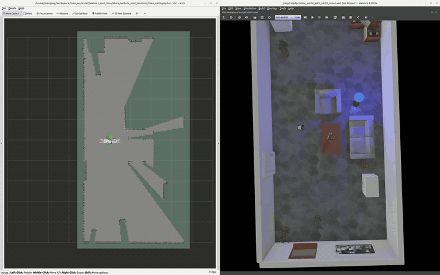
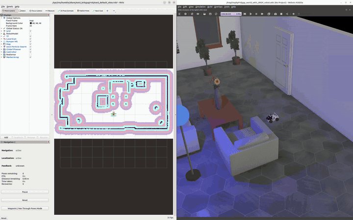
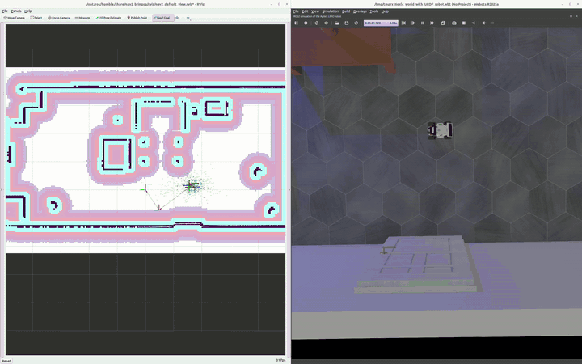

# webots_ros2_limo

AgileX **LIMO Pro** (four-wheel differential drive, or mecanum wheels) in [Webots](https://cyberbotics.com), driven by `webots_ros2_driver` + `ros2_control`, with cartographer SLAM and Nav2 navigation.

Tested on **Ubuntu 22.04 / ROS 2 Humble / Webots R2025a**.

---

## 1. Install Dependencies

```bash
sudo apt update
sudo apt install \
  ros-humble-webots-ros2 \
  ros-humble-ros2-control \
  ros-humble-ros2-controllers \
  ros-humble-teleop-twist-keyboard \
  ros-humble-cartographer-ros \
  ros-humble-nav2-bringup
```

Webots R2025a must be installed at `/usr/local/webots` (or exported via `WEBOTS_HOME` / `ROS2_WEBOTS_HOME`).

## 2. Clone & Build

```bash
# in your ROS 2 workspace root (e.g. ~/my_ros2_ws)
git clone https://github.com/inmo-jang/webots_ros2_limo.git src/webots_ros2_limo
colcon build --packages-select webots_ros2_limo
source install/local_setup.bash
```

---

## 3. Run the Simulator

```bash
ros2 launch webots_ros2_limo robot_launch.py
```

This starts Webots with the LIMO robot, the `webots_ros2_driver`, the `ros2_control` spawners and `robot_state_publisher`.
The `limo_sensors` plugin publishes the sensors and `/odom` with the `odom -> base_link` TF, taking distance from the wheel encoders and heading from the IMU.

Drive it with the keyboard:

```bash
ros2 run teleop_twist_keyboard teleop_twist_keyboard
```

`i` forward, `,` backward, `j`/`l` rotate, `u`/`o` forward + rotate.
`w`/`x` change linear speed, `e`/`c` angular.

### Launch arguments

| Argument | Default | Purpose |
|---|---|---|
| `drive` | `diff` | `diff` (four-wheel differential) or `mecanum` (omnidirectional, see step 6) |
| `world` | per `drive` | World file from `worlds/`: `limo_world.wbt` or `limo_world_mecanum.wbt` |
| `mode` | `realtime` | Webots startup mode (`realtime`, `fast`, `pause`) |
| `slam` | `false` | Also start SLAM + RViz in the same command |
| `nav` | `false` | Also start Nav2 + RViz in the same command |
| `map` | `resource/limo_world_map.yaml` | Map used when `nav:=true` |
| `use_sim_time` | `true` | Use the Webots `/clock` as ROS 2 time |

---

## 4. SLAM (cartographer)

Use **two terminals**.
Source your workspace in each one.

**Terminal 1** — wait until Webots is open and the robot is standing in the world before going on:

```bash
ros2 launch webots_ros2_limo robot_launch.py
```

**Terminal 2** — cartographer + RViz:

```bash
ros2 launch webots_ros2_limo cartographer_launch.py
```

Drive around with the keyboard teleop to build the map, then save it:

```bash
ros2 run nav2_map_server map_saver_cli -f limo_map
# Output in the current directory: limo_map.yaml, limo_map.pgm
```



| Argument | Default | Purpose |
|---|---|---|
| `use_rviz` | `true` | Open RViz with the SLAM view |
| `configuration_basename` | `limo_lds_2d.lua` | Cartographer lua config in `resource/` |
| `resolution` | `0.05` | Occupancy grid cell size [m] |
| `use_sim_time` | `true` | Use the Webots `/clock` as ROS 2 time |

---

## 5. Navigation (Nav2 + AMCL)

Again **two terminals**.

**Terminal 1** — wait until Webots is open before going on:

```bash
ros2 launch webots_ros2_limo robot_launch.py
```

**Terminal 2** — Nav2 + AMCL + RViz:

```bash
ros2 launch webots_ros2_limo nav2_launch.py
```

In RViz, click **2D Pose Estimate** to set the robot's initial pose, then **Nav2 Goal** to send it somewhere.
Or from the command line:

```bash
ros2 action send_goal /navigate_to_pose nav2_msgs/action/NavigateToPose \
  "{pose: {header: {frame_id: map}, pose: {position: {x: 1.1, y: -3.6}, orientation: {w: 1.0}}}}"
```



| Argument | Default | Purpose |
|---|---|---|
| `drive` | `diff` | Selects the default `params_file`; use the same value as in terminal 1 |
| `map` | `resource/limo_world_map.yaml` | Map yaml for AMCL to localise against |
| `params_file` | `resource/<drive>/nav2_params.yaml` | Nav2 parameter file |
| `use_rviz` | `true` | Open RViz with the Nav2 view |
| `use_sim_time` | `true` | Use the Webots `/clock` as ROS 2 time |

To navigate with your own map from step 4, run this from the directory where you saved it:

```bash
ros2 launch webots_ros2_limo nav2_launch.py map:=limo_map.yaml
```

---

## 6. Mecanum Drive

With mecanum wheels the LIMO also moves sideways.
Add `drive:=mecanum` to the launch commands of steps 3-5; everything else stays the same.

```bash
ros2 launch webots_ros2_limo robot_launch.py drive:=mecanum
```

`/cmd_vel` then also takes `linear.y` (positive = left):

```bash
ros2 topic pub -r 20 /cmd_vel geometry_msgs/msg/Twist "{linear: {y: 0.1}}"
```

In `teleop_twist_keyboard`, hold **Shift** for sideways motion: `J`/`L` strafe left/right, `U`/`O`/`M`/`>` move diagonally.

For navigation, start Nav2 with the same drive:

```bash
ros2 launch webots_ros2_limo nav2_launch.py drive:=mecanum
```

The robot keeps its heading while it drives and turns to the goal heading only after it has arrived:



| | `drive:=diff` | `drive:=mecanum` |
|---|---|---|
| Robot model | `LimoFourDiff.proto` | `LimoMecanum.proto` |
| Controller | `diff_drive_controller` | `mecanum_drive_controller` |
| Nav2 controller | DWB | DWB, holonomic (keeps its heading while driving) |
| AMCL motion model | differential | omnidirectional |

The mecanum rollers are not modelled geometrically: as in the Webots KUKA youBot, each wheel has an asymmetric contact friction rotated by ±45°, defined in `worlds/limo_world_mecanum.wbt`.

---

## SCD41 Arduino CO2 sensor

The SCD41 sketch is in `arduino/scd41_serial/scd41_serial.ino`. Install **Sensirion I2C SCD4X** and its **Sensirion Core** dependency from Arduino IDE Library Manager. On an Uno, connect SDA to A4, SCL to A5, and GND to GND; power the breakout according to its board requirements (the sensor supports 2.4-5.5 V, with 3.3 V recommended). The sketch uses the normal periodic measurement mode, which produces a new reading about every 5 seconds.

Upload the sketch and open Serial Monitor at 115200 baud. Each valid measurement prints only a CO2 ppm number, for example:

```text
623
```

`SCD41_START_ERROR` means periodic measurement did not start. CO2 is in ppm and a new reading is normally available about every 5 seconds. The current `mq3_serial_bridge` accepts only `MQ3,<sequence>,<adc>`, so this numeric SCD41 stream is not yet connected to ROS; the bridge parser and ROS message topics must be adapted separately before using it with `auto_explorer`.

## MQ-3 Arduino ethanol sensor

The Arduino Uno sketch is in `arduino/mq3_serial/mq3_serial.ino`. Connect the MQ-3 module's `AO` to Arduino `A0`, `VCC` to a regulated 5 V supply, and `GND` to both the supply ground and Arduino ground. Connect the Uno to the LIMO Pro computer over USB. Do not power the MQ-3 heater from an Arduino I/O pin, and ensure the analog output does not exceed 5 V.

The sketch sends `MQ3,<sequence>,<adc>` at 9600 baud, about 1.7 times per second. Build and source the ROS 2 workspace, then run the bridge in one terminal:

```bash
ros2 run webots_ros2_limo mq3_serial_bridge --ros-args -p port:=/dev/ttyACM0
```

The bridge reconnects if the serial device is temporarily unavailable and publishes:

| Topic | Type | Meaning |
|---|---|---|
| `/gas/mq3/raw_adc` | `UInt16` | Arduino ADC reading, 0-1023 |
| `/gas/mq3/voltage` | `Float32` | Approximate analog input voltage; `adc_reference_voltage` defaults to 5.0 V |
| `/gas/mq3/ethanol_ppm` | `Float32` | Piecewise-linear estimate from configured calibration points; only published inside their ADC range |

### MQ-3 baseline and response-delay logging

Warm up the MQ-3 first, keep it in clean air, and keep the robot stationary. In another terminal run the CSV logger; by default it records a 60-second baseline and writes `~/mq3_characterization.csv`:

```bash
source install/local_setup.bash
ros2 run webots_ros2_limo mq3_characterization_logger --ros-args \
  -p output_csv:=~/mq3_characterization.csv \
  -p baseline_duration_sec:=60.0
```

The logger calculates baseline median/MAD and trigger/release thresholds from the observed variation. After it reports `Baseline ready`, mark the start and end of a controlled exposure from another terminal:

```bash
ros2 topic pub --once /gas/characterization/exposure_start std_msgs/msg/Empty "{}"
ros2 topic pub --once /gas/characterization/exposure_end std_msgs/msg/Empty "{}"
```

The CSV records every ADC sample, host wall/monotonic time, the latest `/odom` pose, baseline statistics, and voltage estimated using `adc_reference_voltage`. It also records the first threshold-crossing delay, confirmed response delay, and recovery delay. These delays are end-to-end from the manual marker to ROS receipt and include sensor response, Arduino sampling, serial transfer, and ROS delivery; the pose is the latest odometry at receipt, so keep the robot stopped for these measurements. The logger observes only and does not change explorer thresholds or publish motion commands. MQ-3 is not a certified safety detector; use a controlled, ignition-free test setup and do not use a lighter/flame for calibration.

MQ-3 requires warm-up and calibration against known ethanol concentrations before its output can be interpreted quantitatively. No default calibration is assumed: until calibration is configured, only raw ADC and voltage are published. Record ADC values under at least two known concentrations and pass matching, monotonic arrays; for example, `calibration_adc` contains the readings and `calibration_ppm` the corresponding known concentrations in the same order. Do not use arbitrary example values as a real calibration. Values outside the calibrated ADC range do not produce an ethanol ppm message.

```bash
ros2 run webots_ros2_limo mq3_serial_bridge --ros-args \
  -p port:=/dev/ttyACM0 \
  -p calibration_adc:="[<adc_at_low_ppm>, <adc_at_high_ppm>]" \
  -p calibration_ppm:="[<low_ppm>, <high_ppm>]"
```

Replace the placeholders with numeric calibration measurements before running; the command above is a template, not directly executable. If the Uno appears as a different device, pass its path (preferably `/dev/serial/by-id/...`) as `port`.

To stop frontier exploration when the raw ADC reaches a threshold, run the explorer in a second terminal:

```bash
ros2 run webots_ros2_limo auto_explorer --ros-args -p gas_adc_stop_threshold:=400
```

The explorer stops on the first sample at or above 400 ADC. Three consecutive high samples confirm persistent detection; three consecutive samples at or below the 360 ADC release threshold resume frontier exploration. Persistent detection starts an adaptive stop-measure-move search: it waits 5 seconds at each stop, records the median of 3 ADC samples and their time slope, then moves one 0.3 m step. The next direction continues along the last movement when `(spatial ADC change + clipped rate × rate_weight_sec)` reaches 15 ADC; otherwise it turns by a non-cardinal 137.5 degrees and tries another nearby step. The rate contribution is clipped to `gas_probe_max_rate_gain` so a brief noisy slope cannot dominate. After 3 consecutive unhelpful steps or 5 total moves, the robot returns to the position with the highest measured median and stops. A move or turn times out after 15 seconds. Tune `gas_adc_stop_threshold`, `gas_adc_release_threshold`, `gas_confirm_samples`, `gas_probe_distance`, `gas_probe_settle_sec`, `gas_probe_sample_count`, `gas_probe_min_delta`, `gas_probe_rate_weight_sec`, `gas_probe_max_rate_gain`, `gas_probe_max_moves`, `gas_probe_max_flat_steps`, `gas_probe_heading_change_deg`, `gas_probe_arrival_tolerance`, `gas_probe_turn_tolerance`, and `gas_probe_move_timeout_sec` for the test environment. MQ-3 response can be much slower than serial sampling, so validate the 5-second settling period experimentally. This behavior applies to `auto_explorer` only, not teleop or Nav2 commands.

## Depth 3D scan (`depth_3d_scan/`)

After `auto_explorer` finishes the gas search (`GAS_STOPPED`), the robot turns in place and records the depth camera, then a colored 3D mesh of the spot is reconstructed on the laptop. Details: [`depth_3d_scan/README.md`](depth_3d_scan/README.md)

Run the explorer with its velocity remapped so the scan node takes over only while scanning:

```bash
ros2 run webots_ros2_limo auto_explorer --ros-args -r /cmd_vel:=/cmd_vel_explorer
python3 depth_3d_scan/auto_scan_node.py --ros-args -p start:=explorer -p explorer_cmd_topic:=/cmd_vel_explorer
```

Reconstruct on the laptop (`pip install open3d==0.19.0 rosbags "numpy<2"`). Noise is removed before export, and the output is a compact binary PLY (float32 xyz + uint8 rgb, no normals) for the OpenGL viewer:

```bash
python3 depth_3d_scan/reconstruct_from_bag.py ~/scan_<date>_small --out scene.ply --gl
```

Then open the resulting `scene.ply` in the OpenGL viewer.

## AMG88xx Arduino thermal camera test

The AMG88xx test sketch is in `arduino/amg88xx_test/amg88xx_test.ino`. In Arduino IDE, install **Adafruit AMG88xx** from Library Manager (also install **Adafruit BusIO** if prompted), select the board and port, then upload the sketch. For an Arduino Uno, select **Arduino Uno**. Connect the AMG88xx breakout's power, ground, SDA, and SCL pins to the matching board pins.

Open Serial Monitor at **115200 baud**. The sketch prints an initialization message and then sends each 8×8 temperature frame as 64 comma-separated values. If initialization fails, it reports an error and retries every second instead of silently stopping; check the I2C wiring and the sensor's I2C address (default `0x69`). A compile error saying `Adafruit_AMG88xx.h: No such file or directory` means the Adafruit AMG88xx library is not installed.

## Sensors

The default launch (no SLAM / Nav2, either `drive:=diff` or `drive:=mecanum`) publishes the same sensor interface as the real LIMO running `ros2 launch wego teleop_launch.py`: same topic names, message types, `frame_id`s, rates, QoS and TF frames, measured on the robot.
Code written against the simulator therefore runs on the robot unchanged.

| Topic | Type | Rate | frame_id | Notes |
|---|---|---|---|---|
| `/scan` | `LaserScan` (BEST_EFFORT) | 10 Hz | `laser_link` | YDLIDAR, ±110°, 248 beams, `range_min` 0.01 / `range_max` 64, no return = `0.0` |
| `/imu` | `Imu` | 100 Hz | `imu_link` | gravity included, same covariances as `limo_base` |
| `/odom` | `Odometry` | 50 Hz | `odom` → `base_link` | wheel encoders + IMU heading, with the `odom → base_link` TF |
| `/joint_states` | `JointState` | 25 Hz | `base_link` | real wheel angles (`joint_state_broadcaster`); the robot publishes zeros at 10 Hz |
| `/camera/color/image_raw` (+`/compressed`) | `Image` rgb8 640×480 | ~30 Hz | `camera_color_optical_frame` | Orbbec DaBai DC1 |
| `/camera/depth/image_raw` (+`/compressed`, `/compressedDepth`) | `Image` 16UC1 [mm] 640×480 | ~30 Hz | `camera_color_optical_frame` | aligned to color, 0.3–3 m, 0 = no data |
| `/camera/ir/image_raw` (+`/compressed`) | `Image` mono16 640×400 | ~30 Hz | `camera_color_optical_frame` | |
| `/camera/{color,depth,ir}/camera_info` | `CameraInfo` | ~30 Hz | `camera_color_optical_frame` | intrinsics copied from the robot |
| `/camera/depth/points` | `PointCloud2` xyz | ~30 Hz | `camera_color_optical_frame` | |
| `/camera/depth_registered/points` | `PointCloud2` xyz+rgb | ~30 Hz | `camera_color_optical_frame` | |

> **Note:** The main sensors (LiDAR, IMU, wheel odometry and the depth camera) are simulated as listed above, but some other topics of the real robot are not.

Robot control: `/cmd_vel` in (`linear.x`, `angular.z`; with `drive:=mecanum` also `linear.y`), `/odom` and `odom -> base_link` TF out.

---

## Package Layout

```
webots_ros2_limo/
├── launch/
│   ├── robot_launch.py         # Webots + driver + ros2_control spawners
│   ├── cartographer_launch.py  # cartographer_ros nodes + RViz
│   └── nav2_launch.py          # nav2_bringup + RViz, with this package's map
├── protos/
│   ├── LimoFourDiff.proto      # AgileX LIMO robot model (4-wheel diff)
│   ├── LimoMecanum.proto       # same robot with mecanum wheels
│   └── meshes/                 # limo_base.dae, limo_wheel.dae
├── resource/
│   ├── limo.urdf               # Webots driver plugins (limo_sensors + ros2_control)
│   ├── limo_lds_2d.lua         # cartographer config
│   ├── limo_world_map.{yaml,pgm}
│   ├── diff/
│   │   ├── ros2control.yaml    # diff_drive_controller config
│   │   └── nav2_params.yaml    # Nav2 parameters (DWB)
│   └── mecanum/
│       ├── ros2control.yaml    # mecanum_drive_controller config
│       └── nav2_params.yaml    # Nav2 parameters (DWB, holonomic)
├── webots_ros2_limo/
│   └── limo_sensors.py         # /scan, /imu, /odom, /camera/* like the real robot
├── depth_3d_scan/              # depth camera 3D scan & reconstruction (see its README)
├── doc/
│   └── cartographer.gif, nav2.gif, mecanum.gif
├── rviz/
│   └── limo_cartographer.rviz  # SLAM view
└── worlds/
    ├── limo_world.wbt          # apartment world, LimoFourDiff
    └── limo_world_mecanum.wbt  # same world, LimoMecanum
```
