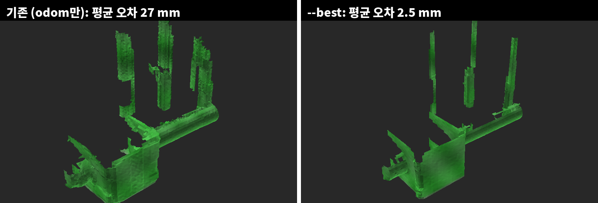

# depth_3d_scan

가스 탐색이 끝난 지점 주변을 LIMO 뎁스 카메라로 여러 각도에서 찍고, 색이 입혀진 3D 메시(`.ply`)로 재구성합니다.


| 파일 | 위치 | 역할 |
| --- | --- | --- |
| `auto_scan_node.py`, `scan_motion.py` | 로봇 | 멈췄다 움직이며 자동 녹화 |
| `shrink_bag.py` | 로봇 | 필요한 프레임만 남겨 bag 축소 |
| `reconstruct_from_bag.py` | 노트북 | bag → 3D 메시 |
| `show_mesh_rviz.py`, `scene_mesh.rviz` | 노트북 | RViz 로 보기 |

## 설치
```bash
pip install rosbags                                  # 로봇
pip install open3d==0.19.0 rosbags "numpy<2"         # 노트북 (open3d 0.20 은 결과가 비어 나옴)
```

## auto_explorer 와 함께 실행
가스 탐색이 끝나면(`GAS_STOPPED`) 자동으로 제자리 한 바퀴 촬영합니다. 기존 코드는 수정하지 않고, explorer 의 속도 명령만 다른 토픽으로 돌려 촬영 중에 섞이지 않게 합니다.
```bash
ros2 run webots_ros2_limo auto_explorer --ros-args -r /cmd_vel:=/cmd_vel_explorer
python3 auto_scan_node.py --ros-args -p start:=explorer -p explorer_cmd_topic:=/cmd_vel_explorer
```
- 평소: explorer 명령을 `/cmd_vel` 로 그대로 전달
- explorer 가 `staying stopped` / `Adaptive search stopped` 로그를 남기면 → 촬영 → `~/scan_<날짜>_small`
- 상태: `/scan_status` (`recording` → `moving k/n` → `shrinking` → `done:<경로>`)

단독 실행: `python3 auto_scan_node.py` (바로 시작) 또는 `-p start:=service` + `ros2 service call /start_scan std_srvs/srv/Trigger`

| 패턴 | 움직임 | 언제 |
| --- | --- | --- |
| `panorama` | 제자리 30도씩 한 바퀴 | 물체 방향을 모를 때 (explorer 연동 기본값) |
| `arc` | 물체 주위 부채꼴 ±30도 | 물체가 앞에 있을 때, 3D 가장 정확 |
| `approach` | 좌우로 흔들며 접근 | 제자리 회전이 안 될 때 (단독 기본값) |

## 재구성 (노트북)
```bash
python3 reconstruct_from_bag.py scan_..._small --every 1 --max-dt 0.1 --depth-trunc 1.5 --best --out scene.ply
python3 show_mesh_rviz.py scene.ply                  # 터미널 A
rviz2 -d scene_mesh.rviz                             # 터미널 B
```
- 위치: 바퀴 오도메트리 + ICP 보정. ICP 는 바닥 로봇에 맞게 제자리 회전이면 수평 회전만, 이동했으면 바닥 이동 + 수평 회전만 고칩니다 (`--icp-mode auto`).
- `--best` = `--icp` + `--edge-filter`(경계 잡음 제거) + `--stationary`(멈춘 프레임만)

## 정확도 (가짜 데이터: 바퀴 미끄러짐·시간차·경계 잡음 포함)
| 상황 | odom 만 | `--best` |
| --- | --- | --- |
| 부채꼴 이동 (`arc`) | 27 mm | 2.7 mm |
| 제자리 한 바퀴 (`panorama`) | 34 mm | 9 mm |



## 한계
- 카메라가 본 면만 복원, 해상도 약 1 cm, 검은색·금속·유리는 구멍, 0.3 m 이내는 안 보임
- `auto_scan_node.py` 는 실물 미시험 — 처음엔 지켜보며 실행
- explorer 종료는 로그 문구로 감지하므로, 문구가 바뀌면 `EXPLORER_DONE` 도 맞춰야 함
