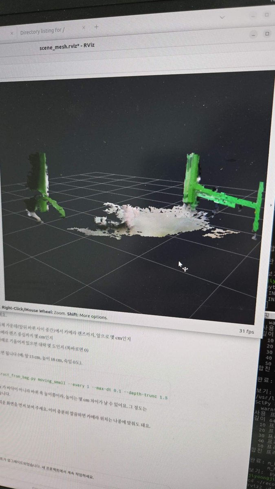

# depth_3d_scan

가스 탐색이 끝난 지점 주변을 LIMO 뎁스 카메라로 여러 각도에서 찍고, 색이 입혀진 가벼운 3D 메시(`.ply`)로 재구성합니다. 결과는 OpenGL 뷰어에서 바로 읽을 수 있는 형식입니다.



| 파일 | 위치 | 역할 |
| --- | --- | --- |
| `auto_scan_node.py` | 로봇 | 멈췄다 움직이며 자동 녹화 |
| `shrink_bag.py` | 로봇 | 필요한 프레임만 남겨 bag 축소 |
| `reconstruct_from_bag.py` | 노트북 | bag → 노이즈 제거된 3D 메시 |

## 설치
```bash
pip install rosbags                                  # 로봇
pip install open3d==0.19.0 rosbags "numpy<2"         # 노트북 (open3d 0.20 은 결과가 비어 나옴)
```

## 촬영 (로봇)
가스 탐색이 끝나면(`GAS_STOPPED`) 자동으로 촬영합니다. 기존 코드는 수정하지 않고, explorer 의 속도 명령만 다른 토픽으로 돌려 촬영 중에 섞이지 않게 합니다.
```bash
ros2 run webots_ros2_limo auto_explorer --ros-args -r /cmd_vel:=/cmd_vel_explorer
python3 auto_scan_node.py --ros-args -p start:=explorer -p explorer_cmd_topic:=/cmd_vel_explorer
```
- 평소: explorer 명령을 `/cmd_vel` 로 그대로 전달
- explorer 가 `staying stopped` / `Adaptive search stopped` 로그를 남기면 → 촬영 → `~/scan_<날짜>_small`
- 상태: `/scan_status` (`recording` → `moving k/n` → `shrinking` → `done:<경로>`)

단독 실행: `python3 auto_scan_node.py` (바로 시작) 또는 `-p start:=service` + `ros2 service call /start_scan std_srvs/srv/Trigger`

| 패턴 (`-p pattern:=`) | 움직임 | 언제 |
| --- | --- | --- |
| `panorama` (기본) | 제자리 30도씩 한 바퀴 | 물체 방향을 모를 때 |
| `arc` | 앞 물체(`target_dist`, 기본 0.9 m) 주위 ±30도 | 물체가 앞에 있을 때, 가장 정확 |

기타 파라미터: `dwell`(멈춤 초, 2.0), `frames`(남길 프레임, 40), `record`, `bag_name`, `shrink`

## 재구성 (노트북)
```bash
python3 reconstruct_from_bag.py ~/scan_<날짜>_small --out scene.ply --gl
```
처리 순서
1. 위치: 바퀴 오도메트리 + ICP 보정 (바닥 로봇이라 제자리 회전이면 수평 회전만, 이동했으면 바닥 이동 + 수평 회전만). 멈춰 있던 같은 자리 프레임은 보정을 재사용해 빠름
2. 깊이 경계의 튀는 점 제거 후 TSDF 로 합침 (해상도 `--voxel`, 기본 1 cm)
3. 내보내기 전 노이즈 제거: 작은 조각 제거 → 표면 매끄럽게(Taubin) → 삼각형 줄이기(`--max-triangles`, 기본 5만)

옵션: `--gl` OpenGL 좌표로 변환, `--no-color` 색 없이 저장, `--depth-trunc` 먼 깊이 자르기(1.5 m), `--raw` 보정·노이즈 제거 없이(비교용)

## 출력 형식 (OpenGL 뷰어용)
```
ply / format binary_little_endian 1.0
element vertex N   : float x, float y, float z, uchar red, uchar green, uchar blue   (15 바이트, 법선 없음)
element face M     : list uchar uint vertex_indices                                  (항상 3, 13 바이트)
```
- 꼭짓점은 `float32 xyz + uint8 rgb` 를 그대로 VBO 에 올리면 됨 (stride 15, 색은 `GL_UNSIGNED_BYTE` 정규화)
- 법선이 없으므로 조명이 필요하면 뷰어에서 면 법선 계산
- `--no-color`: 꼭짓점이 `float32 xyz` 만 남음 (stride 12). 텍스처는 원래 안 쓰고 꼭짓점 색(3 바이트)만 있어서, 빼도 파일 약 8 % (0.50 → 0.46 MB), 재구성 약 0.4 초만 줄고 뷰어 속도는 체감하기 힘듦. 색이 없으면 실물과 비교하기 어려우니 기본은 색 있음
- `--gl`: OpenGL 좌표(x 오른쪽, y 위, z 화면 밖)로 바꾸고, 가운데를 원점·바닥을 y=0 에 맞춤. 없으면 ROS `odom` 좌표(x 앞, y 왼쪽, z 위, 단위 m)

## 결과 (가짜 데이터: 바퀴 미끄러짐·시간차·경계 잡음 포함)
| 상황 | `--raw` | 기본 | 파일 크기 | 시간 |
| --- | --- | --- | --- | --- |
| 부채꼴 이동 (`arc`) | 26 mm | 2.4 mm | 0.2 MB | 2.6 초 |
| 제자리 한 바퀴 (`panorama`) | 34 mm | 9.9 mm | 0.5 MB | 4.6 초 |


## 한계
- 카메라가 본 면만 복원, 해상도 약 1 cm, 검은색·금속·유리는 구멍, 0.3 m 이내는 안 보임
- `auto_scan_node.py` 는 실물 미시험 — 처음엔 지켜보며 실행
- explorer 종료는 로그 문구로 감지하므로, 문구가 바뀌면 `EXPLORER_DONE` 도 맞춰야 함
